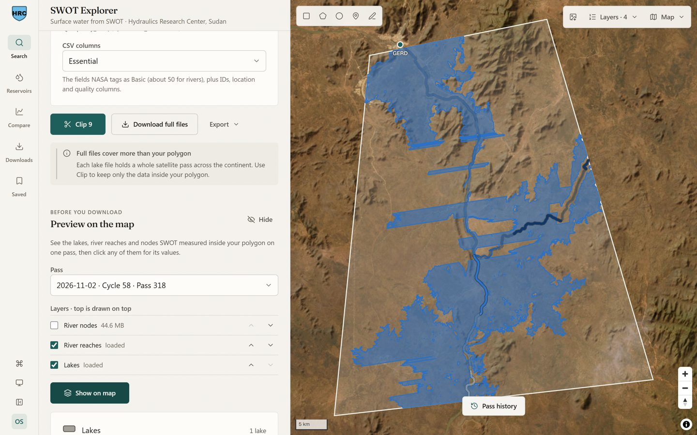
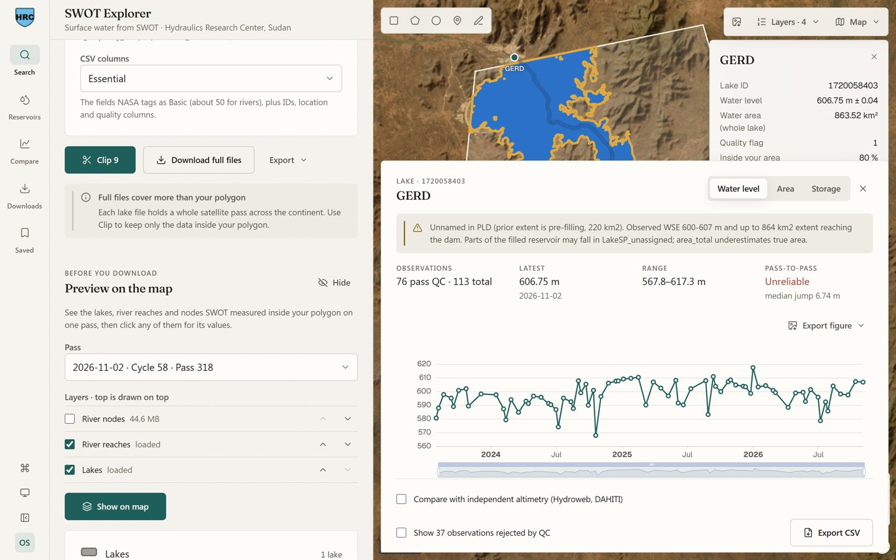
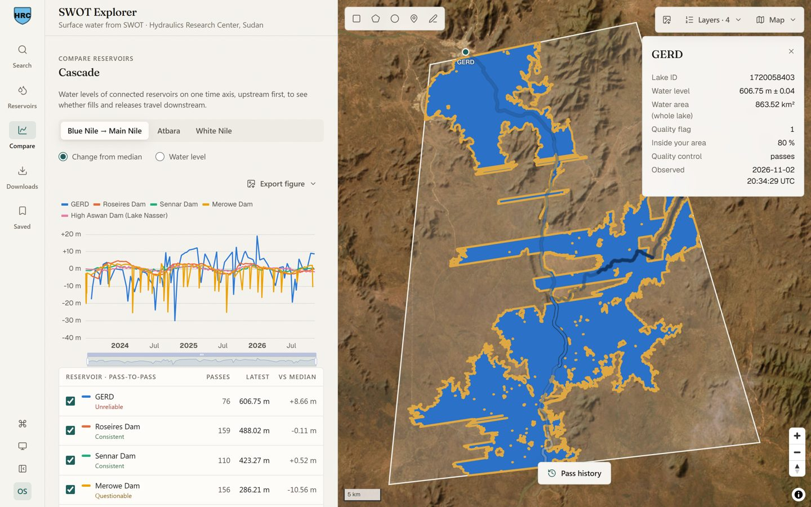

# SWOT Explorer

[](https://doi.org/10.5281/zenodo.24144882)

A browser extension for Chrome and Edge that searches, previews, clips and downloads
[SWOT](https://swot.jpl.nasa.gov/) satellite hydrology data (rivers, lakes, reservoirs and ocean)
without scripts or GIS software.

Developed at the Hydraulics Research Center, Sudan.



## Why

The NASA/CNES Surface Water and Ocean Topography (SWOT) mission measures the height and extent of
rivers and lakes across most of the planet. Its river and lake products are distributed as one file
per satellite pass and continent, so studying a single reservoir normally means downloading dozens
of continental files, unzipping them and clipping them in GIS software.

SWOT Explorer does that work in the browser:

- **Search by study area.** Draw a rectangle or polygon, or upload a shapefile. The search keeps
  only the passes that really observe the area; passes whose continental footprint merely overlaps
  it are skipped.
- **Preview before downloading.** See the lakes, river reaches and nodes measured on a pass on the
  map, and click any feature for its values.
- **Clip in the browser.** Vector products are clipped to the study area and merged; only the data
  inside the polygon is saved.
- **Time series.** Water level, area and estimated storage for a lake or river reach, with quality
  control applied and rejected observations available on request.
- **Reliability grading.** Each series is graded from its pass-to-pass consistency, and the tool
  says so when a number should not be trusted.
- **Validation.** Compare SWOT against your own gauge records and against independent altimetry
  from [DAHITI](https://dahiti.dgfi.tum.de/) and [Hydroweb](https://hydroweb.next.theia-land.fr/).
- **Cascade comparison.** Connected reservoirs on one time axis (the Nile from GERD to Roseires,
  Sennar, Merowe and Aswan is built in).
- **Background downloads.** A queue that keeps running when the panel is closed, plus generated
  download scripts for large jobs.
- **Citations.** Exports carry the data citation and DOI of each collection used.

| Time series with reliability grade | Reservoir cascade |
|---|---|
|  |  |

## Supported products

All products are SWOT Version D collections served by NASA PO.DAAC.

| Group | Products | Clipped in the browser |
|---|---|---|
| Rivers | RiverSP reaches and nodes, RiverAvg | Yes |
| Lakes | LakeSP prior, observed and unassigned, LakeAvg | Yes |
| Water mask | Pixel cloud (PIXC, PIXCVec), Raster 100 m and 250 m | No (selected by tile or scene) |
| Ocean | LR sea surface height: Basic, Expert, Unsmoothed, Wind/Wave | No |

## Install

Downloading and clipping files needs a free
[NASA Earthdata Login](https://urs.earthdata.nasa.gov/). Sign in inside the extension with your
Earthdata username and password, or paste a token generated on the Earthdata site. The password is
used for one request to NASA's token endpoint and is never stored; only the token is kept, locally
in the browser.

### From the Chrome Web Store

Install [SWOT Explorer from the Chrome Web Store](https://chromewebstore.google.com/detail/ocgpjklebbhlgebfnnjhldppponhbage),
then click its icon in the toolbar.

### From source

Requires a current [Node.js](https://nodejs.org/) LTS release and [pnpm](https://pnpm.io/)
(developed with Node.js 24 and pnpm 10).

```sh
git clone https://github.com/Osman-Geomatics93/swot-explorer.git
cd swot-explorer
pnpm install
pnpm build          # Chrome; use `pnpm build:edge` for Edge
```

Then open `chrome://extensions`, turn on **Developer mode**, choose **Load unpacked** and select
`dist/chrome-mv3`.

## Quick start

1. Click the SWOT Explorer icon to open the side panel.
2. Draw a study area around the water you study.
3. Pick a product and dates, then search.
4. Preview a pass on the map and click a lake or reach to open its time series.
5. Clip the results to your area, or queue the full files for download.

## Development

```sh
pnpm dev            # run the extension with live reload
pnpm compile        # type-check
pnpm test           # unit tests (Vitest)
```

The unit tests run offline against recorded API responses in `tests/fixtures`. End-to-end scripts
that drive a real browser are in `tools/`. Notes on the NASA, DAHITI and Hydroweb APIs the
extension relies on are in [docs/api-notes.md](docs/api-notes.md).

Bug reports and suggestions are welcome through
[GitHub issues](https://github.com/Osman-Geomatics93/swot-explorer/issues).

## Data sources and acknowledgements

SWOT Explorer is an independent tool and is not affiliated with or endorsed by NASA or CNES.

- SWOT data: NASA Physical Oceanography Distributed Active Archive Center (PO.DAAC), through the
  Common Metadata Repository, Hydrocron, the Feature Translation Service and Harmony.
- DAHITI: Schwatke, C., Dettmering, D., Bosch, W., Seitz, F. (2015). DAHITI - an innovative approach
  for estimating water level time series over inland waters using multi-mission satellite
  altimetry. *Hydrology and Earth System Sciences*, 19, 4345-4364.
  https://doi.org/10.5194/hess-19-4345-2015
- Hydroweb: Theia / CNES.

Please cite the SWOT collections you use; the extension adds their citations to every export.

## Citing SWOT Explorer

Ibrahim, O. O. A. (2026). *SWOT Explorer: a browser extension to search, preview, clip and download
SWOT satellite hydrology data* (Version 0.1.0) [Computer software]. Zenodo.
https://doi.org/10.5281/zenodo.24144883

The DOI above is for version 0.1.0. To cite the software in general, use
https://doi.org/10.5281/zenodo.24144882, which always resolves to the latest version. The same
metadata is in [CITATION.cff](CITATION.cff) and under **Cite this repository** on GitHub.

## License

[MIT](LICENSE)
